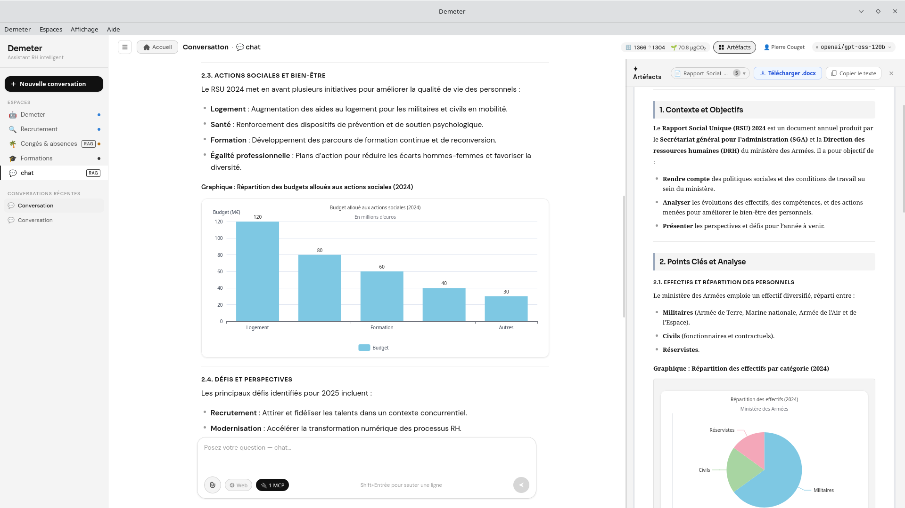

# Demeter

> Assistant RH intelligent — application desktop cross-platform (Tauri v2 · Rust · React)

[](https://github.com/Ktulu-Analog/demeter/actions/workflows/ci.yml)
[](LICENSE)
[](https://tauri.app)
[](https://rustup.rs)

Demeter est un assistant IA spécialisé en ressources humaines (fonction publique d'État dans
sa configuration actuelle, mais vous pouvez modifier les prompts pour l'adapter à vos besoins),
fonctionnant entièrement en local sans service externe — aucun Docker, aucun cloud requis.
Le backend **Rust/Axum** est embarqué dans l'application **Tauri v2** et pilote un LLM
via n'importe quelle API compatible OpenAI (Albert API, OpenAI, Mistral, Ollama…).



---

## Fonctionnalités

| Capacité | Détail |
|---|---|
| 💬 **Chat IA multi-espaces** | Demeter RH, Recrutement, Congés, Fiches de paie, Formations |
| 📚 **RAG (Qdrant)** | Ingestion PDF/DOCX, recherche sémantique + reranking ; stockage vectoriel via **Qdrant** local ou distant |
| 🔌 **MCP** | Serveurs **stdio** (sous-processus gérés par Demeter, pack officiel auto-installé) et **HTTP Streamable** (2025-03-26) |
| 🌐 **Recherche web** | Serveur MCP dédié — activé à la demande via le bouton « Web » ; alias et statut visibles en info-bulle |
| 🎙️ **Transcription audio** | Séparation des locuteurs (diarization), fichiers longs découpés automatiquement, synthèse configurable |
| 📄 **Génération Word** | Export `.docx` depuis le chat, les transcriptions et les synthèses en un clic |
| 📊 **Graphiques ECharts** | Blocs ` ```echarts ` rendus interactivement |
| 🖼️ **Graphiques SVG natifs** | Blocs ` ```svg ` rendus inline avec zoom, copie et téléchargement |
| 📐 **Diagrammes Mermaid** | Flowcharts, séquences, Gantt… |
| ∑ **Formules KaTeX** | Rendu LaTeX inline (`$…$`) et bloc (`$$…$$`) |
| 💾 **Persistance locale** | Conversations en SQLite — aucun compte requis |
| 🖥️ **Cross-platform** | Linux · macOS · Windows |

---

### Stack technique

| Couche | Technologie |
|---|---|
| Desktop shell | [Tauri v2](https://tauri.app) |
| Backend | Rust · [Axum](https://github.com/tokio-rs/axum) · [tokio](https://tokio.rs) |
| Base de données | SQLite via [tokio-rusqlite](https://github.com/programatik29/tokio-rusqlite) |
| Stockage vectoriel | [Qdrant](https://qdrant.tech) local ou distant |
| HTTP client | [reqwest](https://github.com/seanmonstar/reqwest) (rustls, HTTP/2) |
| Frontend | React 18 · TypeScript · Vite |
| Rendu | react-markdown · KaTeX · Mermaid · ECharts · SVG natif |
| Documents | [docx](https://www.npmjs.com/package/docx) (génération Word) |

---

## Prérequis

### Rust ≥ 1.77
```bash
curl --proto '=https' --tlsv1.2 -sSf https://sh.rustup.rs | sh
source ~/.cargo/env
```

### Node.js ≥ 18
```bash
nvm install 20 && nvm use 20
```

### Tauri CLI v2
```bash
cargo install tauri-cli --version "^2"
# ou via npm :
npm install -g @tauri-apps/cli@^2
```

### Qdrant

Qdrant est le moteur de recherche vectorielle utilisé par Demeter pour le RAG. Installez-le localement :

```bash
# Docker (recommandé)
docker run -d -p 6333:6333 -p 6334:6334 \
  -v $(pwd)/qdrant_storage:/qdrant/storage \
  qdrant/qdrant

# ou binaire natif — voir https://qdrant.tech/documentation/guides/installation/
```

L'URL par défaut est `http://localhost:6333`. Vous pouvez pointer vers une instance distante via le champ **URL Qdrant** dans les paramètres ou la variable d'environnement `QDRANT_URL`.

### Dépendances système

**Linux (Debian/Ubuntu)**
```bash
sudo apt update && sudo apt install -y \
  libwebkit2gtk-4.1-dev libgtk-3-dev \
  libayatana-appindicator3-dev librsvg2-dev \
  patchelf build-essential
```

**macOS** — `xcode-select --install`

**Windows** — aucune dépendance supplémentaire (WebView2 inclus avec Windows 10/11).

---

## Démarrage rapide

```bash
git clone https://github.com/Ktulu-Analog/demeter.git
cd demeter

cd frontend && npm install && cd ..
cargo tauri dev
```

`cargo tauri dev` récupère automatiquement les MCP officiels au premier lancement (via `beforeDevCommand` → `npm run predev`, voir § MCP) — inutile de lancer `fetch-mcp-pack.sh` à la main. Les lancements suivants sont instantanés (rien n'est retéléchargé si la version cible est déjà présente). Hors-ligne, le démarrage se poursuit quand même avec un dossier `mcp-servers/` vide ou déjà présent — relancez `./scripts/fetch-mcp-pack.sh` dès que la connexion revient.

L'interface s'ouvre automatiquement.
Le serveur Rust écoute sur `http://localhost:45678`.

### Build production

```bash
npm run tauri:build   # inclut la récupération STRICTE du pack MCP + build frontend + tauri build
```

Contrairement au mode dev, la récupération du pack ici n'a pas de filet de sécurité hors-ligne : si le téléchargement ou la vérification du checksum échoue, le build s'arrête — on ne veut jamais livrer un installeur avec un `mcp-servers/` vide ou périmé.

Équivalent manuel :
```bash
./scripts/fetch-mcp-pack.sh
cd frontend && npm install && npm run build && cd ..
cargo tauri build
```

Les installateurs sont générés dans `src-tauri/target/release/bundle/` :
- Linux : `.deb` + `.AppImage`
- macOS : `.dmg`
- Windows : `.msi` + `.exe`

---

## Configuration

### Connexion au LLM

Au premier lancement, ouvrez **Paramètres** (⌘, / Ctrl+,) et renseignez :

- **Endpoint** — URL de l'API compatible OpenAI  
  ex. `https://albert.api.etalab.gouv.fr/v1`
- **Clé API** — votre token Bearer
- **Modèle** — identifiant du modèle  
  ex. `meta-llama/Llama-3.1-8B-Instruct`

### Connexion Qdrant

Dans les **Paramètres**, section RAG :

- **Clé API Qdrant** — laissez vide si votre instance n'est pas sécurisée ; entrez une clé admin brute ou un JWT pour les instances protégées
- **URL Qdrant** — laissez vide pour utiliser `http://localhost:6333` (défaut), ou saisissez l'URL de votre instance distante

Si votre clé Qdrant est un **JWT** (commence par `eyJ`), vous pouvez également configurer des **tokens par collection** pour un accès granulaire en lecture/écriture.

### Variables d'environnement

| Variable | Défaut | Description |
|---|---|---|
| `QDRANT_URL` | `http://localhost:6333` | URL de l'instance Qdrant |
| `QDRANT_API_KEY` | _(vide)_ | Clé d'accès Qdrant (admin ou JWT) |
| `EMBEDDING_MODEL` | `BAAI/bge-m3` | Modèle d'embedding Albert |
| `EMBEDDING_DIM` | `1024` | Dimension des vecteurs |
| `RERANK_MODEL` | `BAAI/bge-reranker-v2-m3` | Modèle de reranking |
| `RAG_TOP_K` | `20` | Chunks récupérés avant reranking |
| `RAG_TOP_RERANK` | `5` | Chunks conservés après reranking |
| `RAG_MIN_SCORE` | `0.15` | Score minimum (filtre qualité) |
| `RUST_LOG` | `demeter=info` | Niveau de log (`debug`, `info`, `warn`) |

### Espaces & Prompts

Les espaces sont configurés dans `src-tauri/prompts.yml` (embarqué dans le binaire, copié au premier lancement dans le répertoire de données utilisateur). L'éditeur intégré (**Espaces** → ⌘E / Ctrl+E) permet de les modifier sans toucher au YAML.

---

## Données persistées

| OS | Chemin |
|---|---|
| Linux | `~/.local/share/Demeter/` |
| macOS | `~/Library/Application Support/Demeter/` |
| Windows | `%APPDATA%\Demeter\` |

- `conversations.db` — SQLite des conversations
- `prompts.yml` — configuration des espaces

---

## RAG — Ingestion de documents

1. Lancez **Qdrant** (`http://localhost:6333` par défaut)
2. Ouvrez **Collections RAG** (⌘R / Ctrl+R)
3. Créez ou sélectionnez une collection Qdrant
4. Déposez vos fichiers PDF, DOCX, TXT ou Markdown
5. Activez le RAG dans une conversation via le bouton 📚

Pipeline : extraction texte → chunking → embeddings (Albert) → stockage Qdrant → reranking (BGE) → injection contexte.

> **Note** : les valeurs de chunk sont exprimées en **caractères** (et non en tokens).  
> Les valeurs par défaut sont `chunk_size = 2048` et `chunk_overlap = 0`.

Un indicateur en temps réel (vert/rouge) dans la modale RAG signale l'état de la connexion Qdrant.

---

## Rendu graphique

Demeter supporte plusieurs formats de visualisation directement dans le chat :

- **ECharts** — blocs ` ```echarts ` avec JSON de configuration
- **SVG natif** — blocs ` ```svg ` rendus inline avec barre d'outils (copie presse-papier, téléchargement `.svg`)
- **Mermaid** — flowcharts, diagrammes de séquence, Gantt, etc.
- **KaTeX** — formules mathématiques inline et bloc

---

## Transcription audio

Demeter intègre une modale de transcription audio (API Albert `/v1/audio/transcriptions`) :

- **Séparation des locuteurs (diarization)** — chaque segment est attribué à un locuteur, avec fusion automatique des tours de parole consécutifs d'un même locuteur
- **Fichiers longs** — découpage automatique en chunks avant envoi, puis réconciliation des locuteurs entre les segments pour reconstituer un transcript cohérent
- **Synthèses configurables** — génération de résumés à partir de prompts personnalisables (`audio_summary_prompts`)
- **Export Word** — le transcript complet (locuteurs en gras) et chaque synthèse peuvent être exportés en `.docx` en un clic

---

## MCP — Outils externes

Demeter supporte le [Model Context Protocol](https://modelcontextprotocol.io) sous deux transports :

- **stdio** — des serveurs MCP lancés et gérés automatiquement par Demeter comme sous-processus. C'est le mode recommandé : rien à héberger, configuration via le panel **Serveurs MCP** (`Ctrl+M` / `Cmd+M`).
- **HTTP Streamable** (spec 2025-03-26) — pour des serveurs déjà hébergés ailleurs (compatible `mcp.data.gouv.fr` et tout serveur FastMCP stateless), ajoutés par URL depuis le même panel.

Chaque serveur peut recevoir un **alias** affiché dans l'interface. Les outils disponibles sont découverts automatiquement et les statuts de connexion sont visibles en info-bulle au survol des boutons MCP et Web.

Le bouton **Web** active un serveur MCP dédié à la recherche web (configurable séparément) ; il n'est inclus dans les appels que lorsqu'il est allumé.

### MCP officiels (stdio)

Judilibre, Grist, Légifrance et Système de fichiers sont fournis prêts à l'emploi, mais **pas versionnés dans ce dépôt** : leurs sources et binaires précompilés vivent dans [`demeter-mcp-pack`](https://github.com/Ktulu-Analog/demeter-mcp-pack), un dépôt dédié — voir son README pour le détail du cycle de release (cross-compilation 4 plateformes, checksums, releases GitHub).

- `MCP_PACK_VERSION` (racine de ce dépôt) fixe la version du pack embarquée dans les builds Demeter.
- `./scripts/fetch-mcp-pack.sh` télécharge cette version, vérifie son checksum SHA-256, et la déballe dans `src-tauri/mcp-servers/` avant `tauri build` — c'est ce dossier qui est ensuite embarqué comme *resource* Tauri.
- À l'exécution, le bouton **Vérifier les mises à jour** du panel MCP interroge la dernière release publiée sur `demeter-mcp-pack` et propose une mise à jour ponctuelle (téléchargement + vérification + installation non-destructive), sans attendre une nouvelle version de Demeter.

Voir aussi le [guide utilisateur complet des MCP](docs/MCP-Guide-Demeter.md) pour l'installation, la configuration et l'usage au quotidien.

---

## Contribution

Les contributions sont les bienvenues ! Consultez [CONTRIBUTING.md](CONTRIBUTING.md) pour les détails.

```bash
# Fork → branche
git checkout -b feat/ma-fonctionnalite

# Vérifications avant PR
cargo fmt && cargo clippy
cd frontend && npm run typecheck
```

---

## Licence

[AGPL-3.0](LICENSE) — © 2026 **Pierre Couget** — [ktulu.analog@gmail.com](mailto:ktulu.analog@gmail.com)
